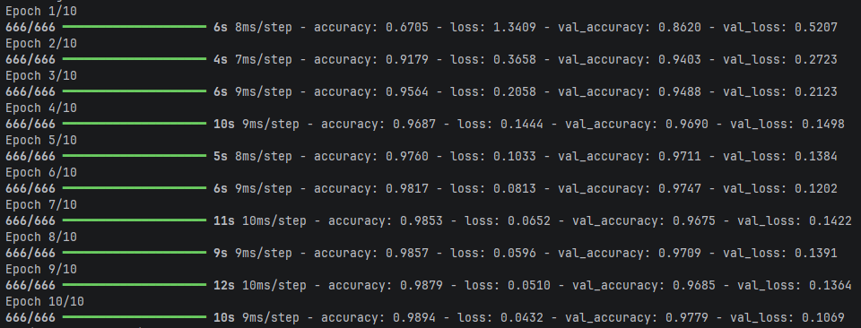
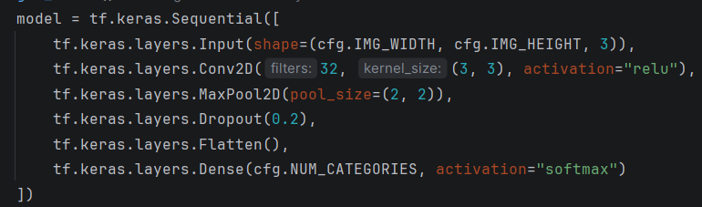

Résumé de mon premier test:
Flatten + dense avec train 91.6% et test 89.1%.

Je m'attendais pas à un résultat aussi bon pour être honnête parce que d'un sens, on traite les pixels directement sans aucun filtre.
De base c'étais juste pour tester le modèle et voir si ça marche, pas grand chose à dire de plus.

Voici mon deuxième et dernier test:

Ici, je remarque que les curves saturent vers 98% donc on peut dire que mes layers ne sont pas parfaits (saturent à un point). Ils montent mais ça ressemble beaucoup à la courbe logarithmique. (commence vite, finit lentement)

Peu d'overfitting parce que la validation et le training se ressemblent fortement:
La seule chose que j'ai remarqué c'est que le loss de la validation ne diminue pas parfaitement. Parfois, il flucue.

Il a bien appris.
Il y'a un peu d'overfitting, mais presque pas (environ 1.5% entre l'apprentissage et les tests.), donc je suis pas trop concerné

Mon modèle:

Voici mon intuition derrière les layers:

Input:
Seulement définir les données de l'information que j'envoie pour que le réseau
sache comment les interpréter (combien de weights et de depth de filtre il doit fournir, etc...)

Conv2D:
Je veux qu'il puisse avoir une logique dans les données qu'il traite, pas seulement interpréter des pixels avec des patterns incompréhensibles à l'oeuil humain.
Un kernel de 3x3 parce que je trouve que 2x2 c'est trop petit alors que 3x3 peut interpréter plus de patterns de taille moyenne comme les coins ou autre.
Pour le relu, je vais être honnête, je l'ai pris car j'ai vu une vidéo qui disait que softmax avait tendance à rester pris dans une courbe au point de ne presque plus changer.
Aussi, je l'ai testé avec softmax (pour Conv2D) et les résultats étaient moins bon (environ 93% de accuracy au test) et je me suis fié à ce que les gens disaient, que relu est celui le plus simple et efficace.

MaxPool2D:
Je veux qu'il compresse les données et garde les plus fortes puisque elles ont déja été interprétées. Ça fait moins d'inputs et ça augmente la vitesse.
2x2 pour diminuer la taille de x2. Si j'avais pas fait Conv2D, il perdrait des informations cruciales mais elles ont déja été traitées donc c'est ok.
32 filtres. Personnelement, le nombre 32 vient du fait que c'est un exposant de deux et je trouve que c'est "clean".
De plus, 32 filtres est parfait selon moi parce que ça permet de repérer plusieurs patterns. J'ai pas testé avec d'autres car l'accuracy me convient.

Dropout:
C'est simple, je veux simplement diminuer les chances d'overfitting. J'ai choisi 0.2 parce que je trouve que c'est juste parfait.
Si j'avais mit plus grand, je trouve qu'il perdrait trop d'information. Il faut garder la balance, et pour moi, cette balance c'est 0.2.

Flatten:
L'information est prête, alots on la flatten pour le passer au réseau de neuronne.

Les layers de output:
Pas besoin de hidden layer selon moi, ça l'améliorerait mais je suis déja à une bonne accuracy et je veux pas que ça prenne trop de temps non plus.
Mes layers sont pas parfaits, mais selon moi, ils sont assez pour le TP.
Un seul layer à la fin est OK selon moi parce que la convolution à pu donner une signification à la data au point qu'on pourrait la considérer comme un hidden layer.
Je n'ai pas testé les couches cachées, mon estimation est que ça rendrait le résultat meilleur mais comme j'ai dit, je ne vise pas la perfection, 97.4% d'accuracy me convient amplement.

L'impacte d'imposer une taille fixe de 30x30:
Si on impose une taille fixe de 30x30, ça fait en sorte qu'on a beaucoup moins d'inputs comparé à une image plus grande, donc ça prends moins de temps à calculer le résultat.
Aussi, ça enlève les plus petits patterns comme des contours très fins et ajoute du "blur", mais puisque on peut tout de même reconnaitre la forme, ça ne dérange pas vraiment.
Par contre, je dirais que 15x15 serait un peu trop petit parce que le texte comme "Stop" pourrait potentiellement devenir illisible. (Je sais que le réseau de neuronne ne peut pas "lire" mais je veut
dire lire les patterns (contours, lignes, etc...))